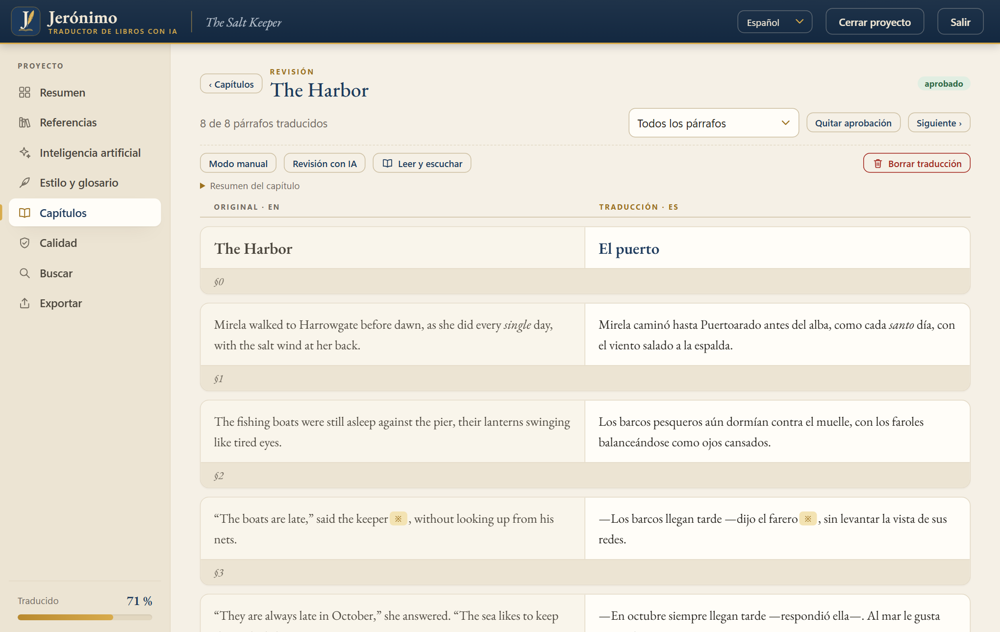
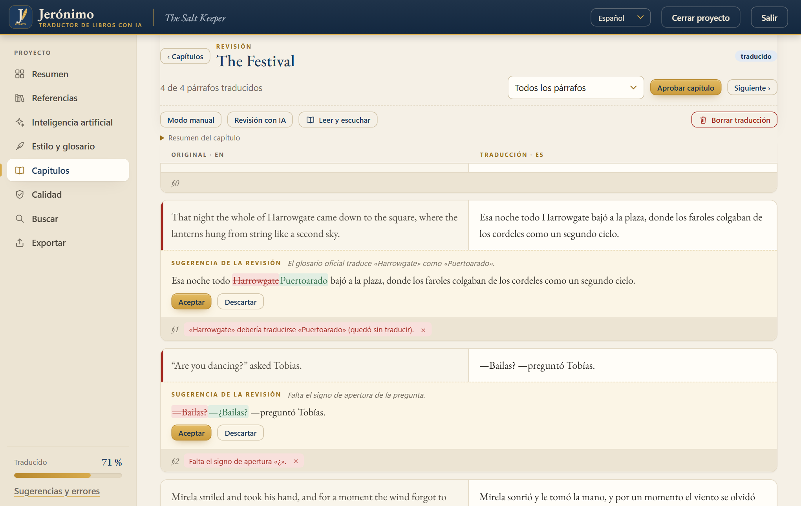
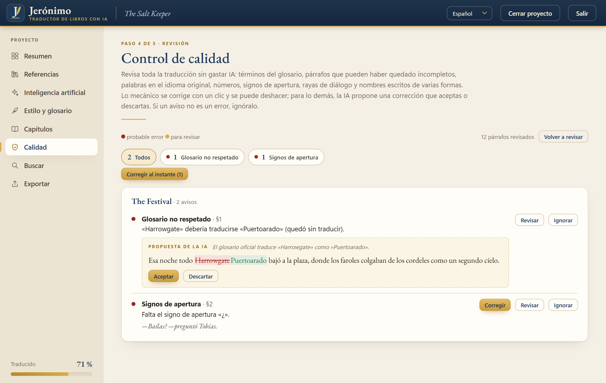
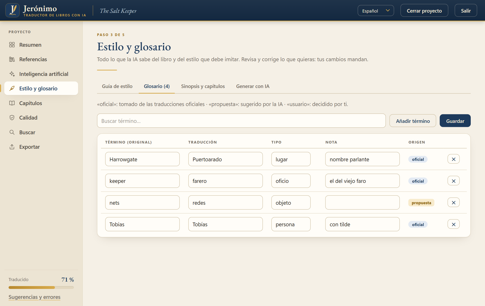
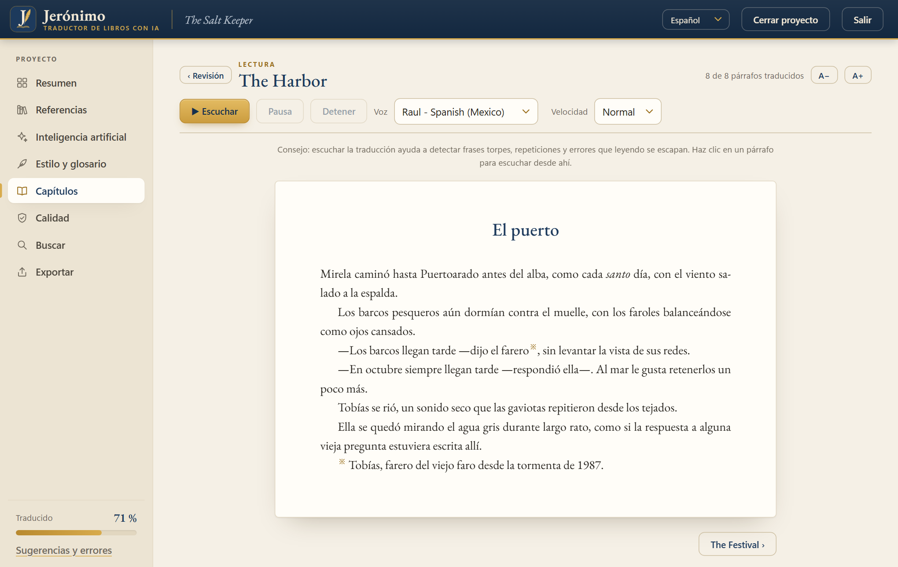
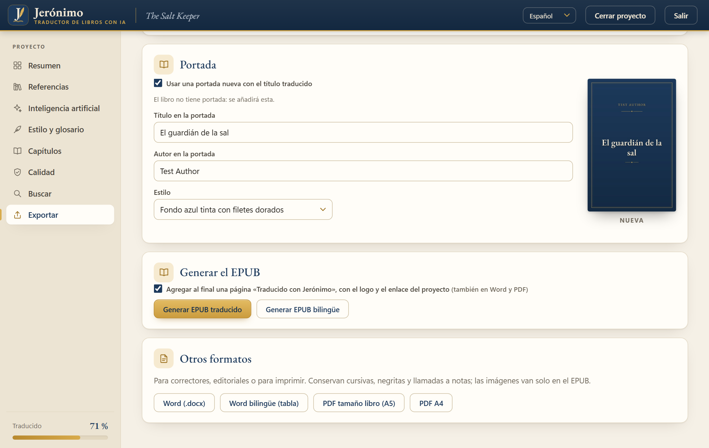
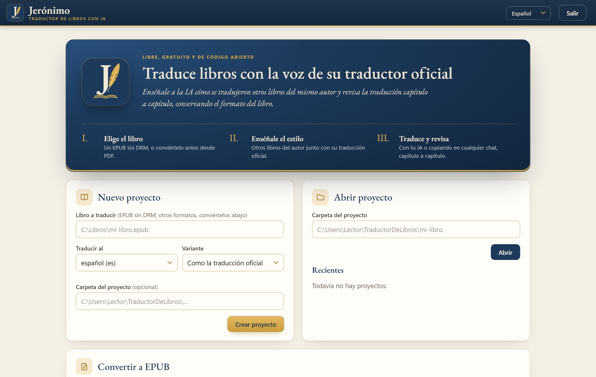
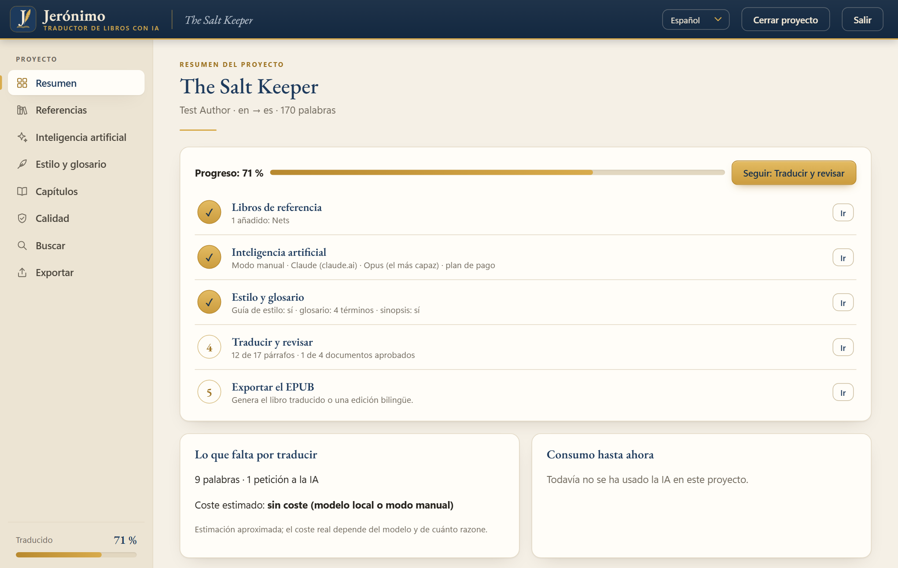

<p align="center"></p>

<h1 align="center">Jerónimo</h1>

<p align="center"><b>Traduce libros con inteligencia artificial imitando la voz de su traductor oficial.</b><br>
Gratis, de código abierto y en español, inglés y portugués.</p>

<p align="center">
  <a href="https://github.com/Willyssj3/Jeronimo/releases/latest/download/Jeronimo-Windows.zip"></a>
</p>

<p align="center">
  <a href="https://github.com/Willyssj3/Jeronimo/releases/latest"></a>
  
  <a href="LICENSE"></a>
</p>

<p align="center"></p>

## ¿Qué es Jerónimo?

**Jerónimo** (por san Jerónimo, patrono de los traductores) traduce libros EPUB con
inteligencia artificial, pero con una diferencia: **aprende cómo traduce el traductor
oficial del autor**.

Le das otros libros del mismo autor junto con su traducción oficial (por ejemplo, el
original en inglés y la edición publicada en español). Jerónimo los empareja párrafo a
párrafo y saca de ahí:

- una **guía de estilo** del traductor: variante del idioma, tuteo o usted, rayas de
  diálogo, tono, cómo trata los nombres;
- un **glosario oficial**: cómo se tradujeron personajes, lugares y términos;
- **ejemplos**: en cada fragmento, la IA ve pasajes parecidos ya traducidos oficialmente
  y los imita.

Además lee el libro entero antes de traducir (sinopsis, resumen de cada capítulo,
personajes) para mantener la coherencia, conserva el formato del EPUB (cursivas, notas al
pie, imágenes, índice) y te deja revisar y aprobar **capítulo por capítulo**.

Funciona con la IA que tengas: con una clave de API (Claude, Gemini, OpenAI…), con un
modelo gratuito en tu propia PC o, **sin clave ninguna, con el chat que ya usas**
(Claude, ChatGPT, Gemini, Copilot…), copiando y pegando.

> ⚠️ Usa Jerónimo solo con libros que tengas derecho a traducir (obras propias, de dominio
> público o con permiso del autor o la editorial). Los libros nunca se suben a este
> repositorio.

## Cómo empezar, en 3 pasos

1. **Descarga** `Jeronimo-Windows.zip` con el botón de arriba.
2. **Descomprime** el archivo: clic derecho → «Extraer todo…» → «Extraer». No lo abras
   desde adentro del ZIP, porque así no funciona.
3. **Abre** `Jeronimo.exe`, dentro de la carpeta. Si Windows muestra «Windows protegió su
   PC», pulsa «Más información» y después «Ejecutar de todas formas». Pasa solo la primera
   vez: el programa todavía no tiene firma digital.

La primera vez, Jerónimo te ofrece crear un acceso directo en el escritorio y en el menú
Inicio. Cuando sale una versión nueva, **te avisa al abrirlo y se actualiza solo con un
clic**: tus proyectos, ajustes y claves no se tocan. Y si a tu PC le falta algo (el
componente de Microsoft para la ventana propia, o Calibre para los libros de Kindle), te
ofrece instalarlo.

## Cómo se usa

1. **Nuevo proyecto**: elige el EPUB que quieres traducir, el idioma y la variante (por
   ejemplo, español rioplatense o de España). ¿Tu libro está en PDF, Word o Kindle? En la
   misma pantalla de inicio lo conviertes a EPUB.
2. **Referencias**: agrega otros libros del autor con su traducción oficial. La app los
   empareja y te muestra la calidad del emparejamiento.
3. **Inteligencia artificial**: elige tu IA y pega tu clave (se guarda en el almacén
   seguro de Windows), o elige el **modo manual** para usar cualquier chat sin clave.
4. **Estilo y glosario**: la IA escribe la guía de estilo, el glosario oficial y el
   análisis del libro. Todo se puede corregir a mano: tus cambios mandan.
5. **Capítulos**: traduce, revisa lado a lado (puedes editar cualquier párrafo o pedir que
   se retraduzca) y aprueba. Lo aprobado sirve de ejemplo para los capítulos siguientes.
6. **Exportar**: genera el EPUB traducido o una edición bilingüe, y también Word o PDF.

## Todo lo que puede hacer

**Traducir con el estilo oficial**
- Emparejamiento de las traducciones oficiales, guía de estilo, glosario y ejemplos en
  cada fragmento.
- Análisis del libro completo: sinopsis, resumen de cada capítulo, personajes y términos.
- **Perfiles de autor**: guarda lo aprendido de un autor y empieza su próximo libro con
  todo listo.

**Con cualquier IA, o sin clave**
- Claude, Google Gemini (con nivel gratuito), OpenAI, OpenRouter, DeepSeek, y modelos
  gratis en tu PC con Ollama o LM Studio.
- **Modo manual**: copias cada bloque en tu chat (Claude, ChatGPT, Gemini, Copilot,
  DeepSeek, Le Chat…) y pegas la respuesta. Eliges el chat, el modelo y tu plan, y la app
  te recomienda el tamaño de cada bloque.
- **Paquete para Proyectos**: si tu chat tiene proyectos (Claude, ChatGPT o las Gems de
  Gemini), subes una sola vez el material de referencia y cada bloque va más liviano.

**Revisar y pulir**
- Revisión lado a lado, con el formato visible, y retraducción de un párrafo.
- **Segunda pasada con IA**: otra lectura propone correcciones (sentido, omisiones,
  glosario, tuteo o usted, puntuación) que aceptas o descartas.
- **Control de calidad sin gastar IA**: términos del glosario, párrafos incompletos,
  palabras sin traducir, números, signos de apertura, rayas de diálogo y nombres escritos
  de varias formas.
- **Correcciones con un clic**: lo mecánico (signos, espacios, rayas, nombres) se arregla al
  instante y se puede deshacer; para lo demás, la IA propone una corrección que aceptas o
  descartas.
- **Buscar y reemplazar** en todo el libro, con deshacer.
- **Lectura en voz alta** del capítulo, como en un lector, para detectar frases torpes.
- Borrar la traducción de un capítulo y recuperarla si te arrepientes.

**Convertir y exportar**
- Convierte a EPUB libros en PDF (también escaneados, con reconocimiento de texto), Word,
  TXT, FB2 y Kindle (MOBI y AZW3).
- Exporta el EPUB traducido o bilingüe, y también a Word (normal o bilingüe) y PDF
  (tamaño libro o A4).
- **Portada traducida** o una imagen tuya, y los datos del libro (título, autor,
  traductor, editorial, ISBN…) editables.
- Al final de cada libro, una página «Traducido con Jerónimo» con el logo y el enlace del
  proyecto (se puede quitar).

**Para todos**
- App en **español, inglés y portugués**, con **modo oscuro**.
- Descarga portable, sin instalar, que se actualiza sola.

## Capturas

<table>
  <tr>
    <td width="50%"><br><sub><b>Segunda pasada con IA</b>: cada sugerencia aparece debajo de su párrafo.</sub></td>
    <td width="50%"><br><sub><b>Control de calidad</b>: avisos sin gastar IA, que se corrigen con un clic.</sub></td>
  </tr>
  <tr>
    <td><br><sub><b>Estilo y glosario</b>: lo oficial, lo que propone la IA y lo que decides tú.</sub></td>
    <td><br><sub><b>Lectura</b>: el capítulo como en un lector, y en voz alta.</sub></td>
  </tr>
  <tr>
    <td><br><sub><b>Exportar</b>: portada traducida y la firma de Jerónimo.</sub></td>
    <td><br><sub><b>Modo oscuro</b>, para leer de noche.</sub></td>
  </tr>
  <tr>
    <td><br><sub><b>Inicio</b>: nuevo proyecto, recientes y conversión a EPUB.</sub></td>
    <td><br><sub><b>Resumen</b>: el progreso y el próximo paso.</sub></td>
  </tr>
</table>

<sub>Las capturas usan un cuento inventado para este proyecto, no un libro real.</sub>

## Modo manual: con cualquier chat de IA, sin clave de API

Si no puedes o no quieres conectar una API, Jerónimo funciona igual con el chat de IA
que ya uses: **Claude (claude.ai, incluido el plan Pro o Max), ChatGPT, Gemini, Copilot,
DeepSeek, Le Chat** o un modelo en tu PC.

1. En **Inteligencia artificial**, elige «Modo manual» y tu chat.
2. En **Estilo y glosario → Generar con IA**, haz los pasos en orden: «Copiar
   instrucciones», pégalas en el chat y pega aquí su respuesta.
3. En cada capítulo, pulsa **«Copiar bloque»**, pégalo en el chat y luego pega la
   respuesta con **«Importar y copiar el siguiente»**.

Cada bloque lleva **todo el contexto que la IA necesita** para traducir como el traductor
oficial: la guía de estilo, el glosario de los términos que aparecen, pasajes parecidos de
las traducciones oficiales, el resumen del capítulo y los párrafos anteriores. Así no
importa si usas el mismo chat o uno nuevo para cada bloque. Si la respuesta llega cortada,
lo que falte vuelve en el siguiente bloque.

## Idioma de la app: español, inglés o portugués

Para cambiar el idioma de la app, elige **Español**, **English** o **Português** en el
menú de idioma de la barra superior (arriba a la derecha). El cambio es inmediato y queda
guardado para la próxima vez. La primera vez, la app usa el idioma de Windows (si es otro
distinto de esos tres, inglés).

Las notas que escribe la IA (dudas, motivos de las correcciones, guía de estilo,
resúmenes) salen en el idioma que tengas elegido en ese momento. El idioma al que se
traduce el libro es otra cosa: se elige al crear el proyecto, en «Traducir al».

## IA compatibles

| Proveedor | Coste | Notas |
|---|---|---|
| **Claude** (Anthropic) | Pago por uso | La mejor calidad literaria. Necesita una **clave de API** de [console.anthropic.com](https://console.anthropic.com); la suscripción de claude.ai (Pro o Max) no se puede usar en otras apps, pero sí en el modo manual. |
| **Google Gemini** | Tiene nivel gratuito | Clave gratis en Google AI Studio, con límites de uso. |
| **OpenAI**, **OpenRouter**, **DeepSeek** | Pago por uso | Y cualquier servicio compatible con la API de OpenAI. |
| **Ollama**, **LM Studio** | Gratis | Modelos que funcionan en tu propia PC (calidad menor; necesitan una buena tarjeta gráfica). |
| **Modo manual** | Incluido en tu plan | Con cualquier chat de IA, sin clave. La app copia cada bloque con todo su contexto, lo pegas en el chat y pegas la respuesta. |

## Preguntas frecuentes

**¿Cuánto cuesta?**
Jerónimo es gratis. Lo único que puede costar es la IA: en modo manual usas tu chat de
siempre (incluso en su plan gratuito); con una clave de API pagas lo que uses, y la app te
muestra antes una estimación del costo.

**¿Mis libros se suben a algún lado?**
No. Tus libros y proyectos quedan en tu PC. Solo el texto que traduces viaja a la IA que
elijas (o lo copias tú en el chat, en modo manual). Tus claves se guardan en el almacén
seguro de Windows, nunca dentro de los proyectos.

**¿Qué IA conviene?**
Para la mejor calidad literaria, Claude. Para empezar gratis, Gemini o el modo manual con
el chat que ya uses.

**Windows dice «Windows protegió su PC». ¿Es seguro?**
El aviso aparece porque el programa todavía no tiene firma digital, no porque tenga algo
malo. Pulsa «Más información» y después «Ejecutar de todas formas». El código está
completo en este repositorio, y cada versión se compila automáticamente en GitHub.

**¿Dónde se guardan mis proyectos?**
Por defecto, en `Documentos\TraductorDeLibros`. Al crear un proyecto ves la carpeta y
puedes elegir otra. Actualizar o borrar el programa no los toca.

**¿Cómo lo desinstalo?**
Borra la carpeta de Jerónimo y sus accesos directos. Tus proyectos quedan en Documentos.

**Tengo la versión 0.2.0, la del instalador.**
Descarga el ZIP nuevo con el botón de arriba. La versión vieja la puedes desinstalar desde
Configuración → Aplicaciones: tus proyectos, ajustes y claves se conservan. Desde la 0.3.0,
las actualizaciones llegan solas.

## Para desarrolladores

<details>
<summary>Línea de comandos, desarrollo y estructura del código</summary>

### Línea de comandos

Necesita Python 3.11 o más nuevo:

```bash
pip install -e ".[escritorio]"
jeronimo                           # abre la app
jeronimo --navegador               # la abre en el navegador

traductor nuevo mi-libro "Libro.epub" --destino es
traductor referencia mi-libro "Otro_EN.epub" "Otro_ES.epub"
traductor proveedor mi-libro --tipo anthropic --modelo claude-opus-5-5
traductor preparar mi-libro
traductor traducir mi-libro        # siguiente capítulo
traductor aprobar mi-libro --capitulo 3
traductor exportar mi-libro [--bilingue]
traductor pdf2epub libro.pdf [--salida libro.epub]
```

Otros comandos: `estado`, `modelos`, `omitir`, y el modo manual `prompt` / `importar`.
Las claves se leen de `ANTHROPIC_API_KEY`, `GEMINI_API_KEY`, `OPENAI_API_KEY`, etc., o del
almacén seguro del sistema.

### Desarrollo

```bash
python -m venv .venv && .venv/bin/pip install -e ".[escritorio,dev]"
.venv/bin/python -m pytest
```

| Módulo (`src/traductor/`) | Qué hace |
|---|---|
| `epub.py` | Lee el EPUB, extrae los párrafos traducibles y reconstruye el libro traducido o bilingüe. |
| `inline.py` | Convierte el formato de cada párrafo en marcas (`<g1>…</g1>`, `<x2/>`) que la IA respeta, y lo restaura. |
| `align.py` | Empareja un libro con su traducción oficial (Gale-Church, con nombres propios como anclas). |
| `retrieval.py` | Busca los pasajes oficiales más parecidos a cada fragmento (BM25). |
| `knowledge.py` | Guía de estilo, glosario oficial, análisis del libro y propuesta de términos. |
| `translate.py` | Traducción por bloques con contexto, reintentos, reanudación y modo manual. |
| `review.py`, `qa.py`, `search.py` | Segunda pasada con IA, control de calidad y buscar y reemplazar. |
| `convert.py`, `pdf2epub.py`, `ocr.py` | Conversión de PDF, Word, TXT, FB2 y Kindle a EPUB, con OCR. |
| `export_docs.py`, `cover.py`, `credit.py` | Word y PDF, portada traducida y la firma de Jerónimo. |
| `updates.py`, `components.py` | Actualización automática y programas que pueden faltar. |
| `providers/` | Claude, compatibles con OpenAI (Gemini, DeepSeek…) y Ollama. |
| `app/` | La app: API, servidor local y la interfaz (`ui/`). |

La versión portable se compila en GitHub Actions (`.github/workflows/build.yml`) con
PyInstaller (`packaging/`) y se publica como `Jeronimo-Windows.zip`.

</details>

## Licencia

[MIT](LICENSE). La «J» del logo está trazada con la tipografía EB Garamond, que la
interfaz también usa (incluida en `src/traductor/app/ui/fonts/` bajo la SIL Open Font
License 1.1, con su texto de licencia).

---

**English** · Jerónimo translates EPUB books with AI in the voice of their official
translator: it learns from other books by the same author and their official
translations. Free and open source, for Windows. The app is also available in English:
choose **English** in the language menu at the top right.
[Download for Windows](https://github.com/Willyssj3/Jeronimo/releases/latest/download/Jeronimo-Windows.zip)
(unzip it and open `Jeronimo.exe`).

**Português** · O Jerónimo traduz livros EPUB com IA imitando a voz do tradutor oficial:
ele aprende com outros livros do mesmo autor e as traduções oficiais. Livre e gratuito,
para Windows. O app também está em português: escolha **Português** no menu de idioma, no
canto superior direito.
[Baixar para Windows](https://github.com/Willyssj3/Jeronimo/releases/latest/download/Jeronimo-Windows.zip)
(descompacte e abra `Jeronimo.exe`).
