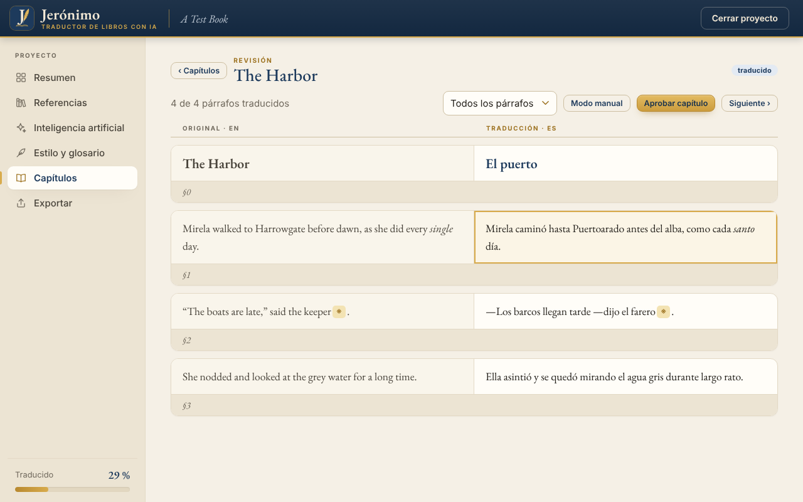

<p align="center"></p>

# Jerónimo — traductor de libros con IA

**Jerónimo** (por san Jerónimo, patrono de los traductores) es una aplicación
gratuita y de código abierto para **traducir libros EPUB con IA imitando el
estilo de las traducciones oficiales del autor**.

La diferencia con otros traductores de EPUB: le das a la app otros libros del
mismo autor junto con su **traducción oficial** (por ejemplo, el original en
inglés y la edición publicada en español). La app los empareja párrafo a
párrafo y aprende de ellos:

- **Guía de estilo** del traductor oficial: variante del idioma, tuteo o usted,
  rayas de diálogo, cómo trata los nombres, el tono…
- **Glosario oficial**: cómo se tradujeron personajes, lugares y términos.
- **Ejemplos**: en cada fragmento, la IA ve pasajes parecidos ya traducidos
  oficialmente y los imita.

Además lee el libro entero antes de traducir (sinopsis, resumen de cada
capítulo, personajes) para mantener la coherencia, conserva el formato del
EPUB (cursivas, notas al pie, imágenes, índice) y permite revisar y aprobar
**capítulo por capítulo**.

Funciona con la IA que cada persona tenga: con una clave de API (Claude,
Gemini, OpenAI…), con un modelo gratuito en el propio PC o, sin clave
ninguna, en **modo manual**, copiando y pegando en cualquier chat de IA.

<p align="center"></p>

> ⚠️ Usa la app solo con libros que tengas derecho a traducir (obras propias,
> de dominio público o con permiso del autor/editorial). Los EPUB nunca se
> suben a este repositorio.

## Instalar en Windows

1. Entra en **[la última versión publicada](https://github.com/Willyssj3/TraductordeLibros/releases/latest)**
   y descarga `Jeronimo-…-instalador.exe` (en «Assets»). No hace falta
   cuenta de GitHub.
2. Ejecútalo. No necesita permisos de administrador. Si Windows muestra
   «Windows protegió su PC», pulsa «Más información» y luego «Ejecutar de
   todas formas» (el instalador todavía no está firmado). También hay una
   versión portátil en ZIP.
3. Abre **Jerónimo** desde el menú Inicio. Cuando salga una versión nueva,
   la app te avisa; el instalador nuevo se instala encima y conserva tus
   proyectos, ajustes y claves.

La app usa el componente WebView2 de Microsoft Edge, incluido en Windows 10 y
11. Si faltara, se abre automáticamente en el navegador.

## Cómo se usa

1. **Nuevo proyecto**: elige el EPUB a traducir, el idioma y la variante.
2. **Referencias**: añade otros libros del autor con su traducción oficial
   (original + traducción). La app los empareja y muestra la calidad.
3. **Inteligencia artificial**: elige tu IA y pega tu clave (se guarda en el
   almacén seguro de Windows). Puedes probar la conexión y ver el coste
   estimado. Si no tienes clave, elige el **modo manual** (ver abajo).
4. **Estilo y glosario**: genera con IA la guía de estilo, el glosario oficial
   y el análisis del libro; revisa y corrige lo que quieras. En modo manual,
   cada paso se hace copiando y pegando en tu chat.
5. **Capítulos**: traduce el siguiente capítulo, revísalo lado a lado (puedes
   editar cada párrafo o pedir que se retraduzca) y apruébalo. Lo aprobado sirve
   de ejemplo para los capítulos siguientes. Puedes omitir páginas que no
   quieras traducir (créditos, publicidad…).
6. **Exportar**: genera el EPUB traducido o una edición bilingüe.

<p align="center"></p>

## Idioma de la app: español, inglés o portugués

Para cambiar el idioma de la app, elige **Español**, **English** o
**Português** en el menú de idioma de la barra superior (arriba a la derecha).
El cambio es inmediato y queda guardado para la próxima vez. La primera vez,
la app usa el idioma de Windows (si es otro distinto de esos tres, inglés).

Las notas que escribe la IA (dudas, motivos de las correcciones, guía de
estilo, resúmenes) salen en el idioma que tengas elegido en ese momento. El
idioma al que se traduce el libro es otra cosa: se elige al crear el proyecto,
en «Traducir al».

> *English:* the app is also available in English: choose **English** in the
> language menu at the top right.
>
> *Português:* o app também está em português: escolha **Português** no menu
> de idioma, no canto superior direito.

## Modo manual: con cualquier chat de IA, sin clave de API

Si no puedes o no quieres conectar una API, Jerónimo funciona igual con el
chat de IA que ya uses: **Claude (claude.ai, incluido el plan Pro o Max),
ChatGPT, Gemini, Copilot, DeepSeek, Le Chat** o un modelo en tu PC.

1. En **Inteligencia artificial**, elige «Modo manual».
2. En **Estilo y glosario → Generar con IA**, haz los pasos en orden (guía de
   estilo, glosario oficial, análisis del libro y propuesta de términos):
   «Copiar instrucciones», pégalas en el chat y pega aquí su respuesta.
3. En cada capítulo, elige tu chat y el tamaño del bloque, pulsa
   **«Copiar bloque»**, pégalo en el chat y luego pega la respuesta con
   **«Importar y copiar el siguiente»**.

Cada bloque lleva **todo el contexto que la IA necesita** para traducir como
el traductor oficial: la guía de estilo, el glosario de los términos que
aparecen, pasajes parecidos de las traducciones oficiales como ejemplo, el
resumen del capítulo, los párrafos anteriores ya traducidos y unas
instrucciones precisas de formato. Así no importa si usas el mismo chat o uno
nuevo para cada bloque. La respuesta llega en un bloque de código fácil de
copiar; si se corta, lo que falte vuelve en el siguiente bloque.

## Convertir PDF a EPUB

En la pantalla de inicio, la tarjeta **«Convertir PDF a EPUB»** transforma un
PDF propio (con texto seleccionable, no escaneado) en un EPUB reflowable listo
para el lector electrónico o para crear un proyecto de traducción:

- Quita encabezados repetidos, números de página e índices impresos.
- Reconstruye los párrafos y une las palabras cortadas con guion, también
  entre páginas.
- Detecta capítulos y subtítulos (y arma el índice del EPUB), cursivas,
  negritas, citas sangradas y separadores.
- Convierte las notas al pie en notas emergentes del EPUB.
- Usa la primera página como portada y toma título y autor del PDF.

Funciona mejor con PDF de imprenta de una sola columna. Los PDF escaneados
necesitan OCR (todavía no incluido). Desde la línea de comandos:
`traductor pdf2epub libro.pdf [--salida libro.epub]`.

## IA compatibles

Cada persona usa su propia IA:

| Proveedor | Coste | Notas |
|---|---|---|
| **Claude** (Anthropic) | Pago por uso | Mejor calidad literaria. Requiere una **clave de API** de [console.anthropic.com](https://console.anthropic.com); la suscripción de claude.ai (Pro/Max) no se puede usar en apps externas. |
| **Google Gemini** | Tiene nivel gratuito | Clave gratis en Google AI Studio, con límites de uso. |
| **OpenAI**, **OpenRouter**, **DeepSeek** | Pago por uso | Cualquier servicio compatible con la API de OpenAI. |
| **Ollama**, **LM Studio** | Gratis | Modelos que funcionan en tu propio PC (calidad menor; requiere buena tarjeta gráfica). |
| **Modo manual** | Incluido en tu plan | Con cualquier chat de IA, sin clave: Claude (también con el plan Pro/Max de claude.ai), ChatGPT, Gemini, Copilot, DeepSeek, Le Chat u otro. La app copia cada bloque con todo su contexto, lo pegas en el chat y luego pegas la respuesta. Bloques de 6.000 a 25.000 caracteres y botón «Importar y copiar el siguiente» para ir rápido. |

## Línea de comandos

Para usuarios avanzados (requiere Python 3.11 o superior):

```bash
pip install -e ".[escritorio]"
jeronimo                           # abre la app
jeronimo --navegador               # la abre en el navegador

traductor nuevo mi-libro "Libro.epub" --destino es
traductor referencia mi-libro "Otro_EN.epub" "Otro_ES.epub"
traductor proveedor mi-libro --tipo anthropic --modelo claude-opus-5-5
traductor preparar mi-libro
traductor traducir mi-libro        # siguiente capítulo
traductor aprobar mi-libro --capitulo 3
traductor exportar mi-libro [--bilingue]
```

Otros comandos: `estado`, `modelos`, `omitir`, y el modo manual `prompt` /
`importar`. Las claves se leen de `ANTHROPIC_API_KEY`, `GEMINI_API_KEY`,
`OPENAI_API_KEY`, etc., o del almacén seguro del sistema.

## Desarrollo

```bash
python -m venv .venv && .venv/bin/pip install -e ".[escritorio,dev]"
.venv/bin/python -m pytest
```

Estructura del código (`src/traductor/`):

| Módulo | Qué hace |
|---|---|
| `epub.py` | Lee el EPUB, extrae los párrafos traducibles y reconstruye el libro traducido o bilingüe. |
| `inline.py` | Convierte el formato interno de cada párrafo en marcas (`<g1>…</g1>`, `<x2/>`) que la IA respeta, y lo restaura. |
| `align.py` | Empareja un libro con su traducción oficial (Gale-Church + nombres propios como anclas). |
| `retrieval.py` | Busca los pasajes oficiales más parecidos a cada fragmento (BM25). |
| `knowledge.py` | Guía de estilo, glosario oficial, análisis del libro y propuesta de términos. |
| `translate.py` | Traducción por bloques con contexto, reintentos, reanudación y modo manual. |
| `providers/` | Adaptadores de Claude, OpenAI-compatibles y Ollama. |
| `project.py` | Carpeta de proyecto y su estado. |
| `app/` | App de escritorio: API, servidor local y la interfaz (`ui/`). |
| `pdf2epub.py` | Conversión de PDF con texto a EPUB 3 (párrafos, capítulos, notas, portada). |
| `cli.py` | Línea de comandos. |

El instalador se construye en GitHub Actions (`.github/workflows/build.yml`)
con PyInstaller e Inno Setup (`packaging/`). Al crear una etiqueta `v*` se
publica automáticamente en *Releases*.

## Licencia

[MIT](LICENSE). La «J» del logo está trazada con la tipografía EB Garamond,
que la interfaz también usa (incluida en `src/traductor/app/ui/fonts/` bajo la
SIL Open Font License 1.1, con su texto de licencia).
